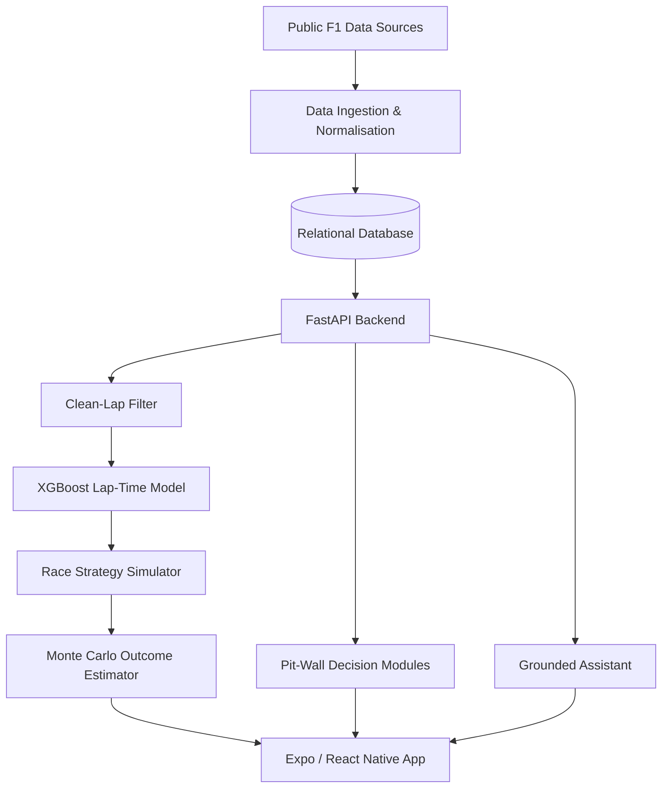

# 🏎️ OpenTyreF1

<div align="center">

  

  <p><b>A Data-Driven Mobile Platform for Formula 1 Telemetry Analysis and Race-Strategy Simulation</b></p>

  
  
  
  

  <br/><br/>

  **From historical race data to smarter strategic decisions.**

</div>

---

## 🏁 About the Project

**OpenTyreF1** is a data-driven Formula 1 analytics platform designed to transform publicly available motorsport data into actionable race-strategy insights.

Instead of only showing historical race results, OpenTyreF1 enables users to analyse telemetry, study tyre degradation, predict lap times, compare race performance, and simulate alternative pit-stop strategies.

The platform combines machine learning, race simulation, historical data, and a cross-platform mobile interface to make advanced motorsport analytics more accessible.

## ✨ Key Features

- 📡 **F1 Data Integration** — Combines Jolpica-F1/Ergast, OpenF1, and FastF1 data sources.
- 🏎️ **Race Explorer** — Browse drivers, races, results, and historical performance.
- 📊 **Telemetry Analysis** — Compare driver performance and race pace.
- 🛞 **Tyre Degradation Modelling** — Analyse tyre performance across different compounds and stints.
- 🤖 **Lap-Time Prediction** — Uses an XGBoost regression model to predict lap-time offsets.
- 🔬 **Strategy Simulation** — Evaluate counterfactual pit-stop and tyre strategies against observed race data.
- 🎲 **Monte Carlo Simulation** — Estimate uncertainty in simulated race outcomes.
- 🧠 **Pit-Wall Decision Support** — Provides strategy-focused analytical modules.
- 💬 **Grounded Assistant** — Answers questions using available race data and analytical results.
- 📱 **Cross-Platform Mobile App** — Built for Android and iOS using Expo and React Native.

## 📈 Research Highlights

The following figures are reported in the project's research paper and thesis.

| Metric | Reported result |
|---|---:|
| Historical race coverage | 492 races |
| Integrated data records | 237,308 |
| Relational database tables | 15 |
| Unseen races used for evaluation | 12 |
| Mean Absolute Error (MAE) | 0.893 seconds |
| Root Mean Squared Error (RMSE) | 1.205 seconds |
| Coefficient of determination (R²) | 0.978 |
| Monte Carlo simulations | 1,500 runs |

> **Research note:** These are reported project evaluation results, not a guarantee of future prediction accuracy. Performance may vary by race, dataset, and evaluation conditions.

## 🛠️ Tech Stack

<div align="center">

  

</div>

| Component | Technology |
|---|---|
| Mobile frontend | Expo, React Native |
| Backend API | FastAPI, Python |
| Machine learning | XGBoost |
| Data processing | Python, pandas |
| Database | SQLite / PostgreSQL |
| ORM | SQLAlchemy |
| Race data | Jolpica-F1, OpenF1, FastF1 |
| Visualisation | react-native-svg |
| Version control | Git and GitHub |

## 🏗️ System Architecture



## 🔍 How It Works

1. **Collect:** Integrate historical results, lap times, tyre stints, pit stops, and other available race data.
2. **Normalise:** Reconcile identifiers across sources and organise records in a relational database.
3. **Filter:** Identify representative clean laps for meaningful performance analysis.
4. **Predict:** Estimate lap-time offsets using the trained XGBoost model.
5. **Simulate:** Calculate hypothetical stint performance and compare the result against observed rival lap times.
6. **Estimate uncertainty:** Use Monte Carlo simulation to analyse the spread of potential finishing positions.
7. **Visualise:** Present race insights and strategy comparisons through the mobile application.

## 🚀 Getting Started

The commands below are a starting point. Adjust paths and environment variables to match the actual repository structure.

### Prerequisites

- Python 3.11 or a version supported by your project
- Node.js and npm
- Git
- Access to the required environment variables and data sources

### 1. Clone the repository

```bash
git clone https://github.com/YOUR_USERNAME/OpenTyreF1.git
cd OpenTyreF1
```

### 2. Set up the Python environment

```bash
python -m venv .venv
```

Activate the environment:

**Windows**
```bash
.venv\Scripts\activate
```

**macOS / Linux**
```bash
source .venv/bin/activate
```

Install dependencies using the project's actual requirements file:

```bash
pip install -r requirements.txt
```

### 3. Start the backend

If the FastAPI application entry point is `app.main:app`, run:

```bash
uvicorn app.main:app --reload
```

Open the API documentation at `http://127.0.0.1:8000/docs`.

### 4. Start the mobile application

Navigate to the actual mobile-app directory and install its dependencies:

```bash
npm install
npx expo start
```

**Important:** The entry point, folder names, Python version, and setup commands are illustrative until checked against your source code.

## 📸 Screenshots & Demo

Add screenshots of your actual application here to showcase its interface.

| Live Dashboard | Telemetry Analysis |
|---|---|
| Add `screenshots/live-dashboard.png` | Add `screenshots/telemetry-analysis.png` |

| Tyre Strategy | Simulation Results |
|---|---|
| Add `screenshots/tyre-strategy.png` | Add `screenshots/simulation-results.png` |

To display a screenshot, upload the corresponding image to the repository and replace the placeholder text with an image link.

## 📚 Research & Documentation

OpenTyreF1 is supported by a project thesis and research paper covering the methodology, architecture, algorithms, and evaluation.

- Project thesis: `docs/OpenTyreF1_Thesis.pdf`
- Research paper: `docs/OpenTyreF1_Research_Paper.pdf`

Update these paths to match the actual filenames and locations in your repository.

## 🗺️ Roadmap

- [x] Integrate public Formula 1 data sources
- [x] Develop a clean-lap filtering pipeline
- [x] Train and evaluate an XGBoost lap-time model
- [x] Build a counterfactual race-strategy simulator
- [x] Implement Monte Carlo outcome estimation
- [x] Develop a cross-platform mobile interface
- [ ] Expand strategy modelling and uncertainty analysis
- [ ] Improve automated testing and deployment
- [ ] Enhance telemetry visualisation and user experience

## 🤝 Contributing

Contributions, suggestions, and bug reports are welcome.

1. Fork the repository.
2. Create a feature branch.
3. Commit your changes.
4. Open a pull request describing the improvements.

Please ensure that contributions respect the terms of the upstream data sources and dependencies.

## ⚠️ Disclaimer

OpenTyreF1 is an independent academic and engineering project. It is not affiliated with, endorsed by, or an official product of Formula 1 or the FIA. All trademarks belong to their respective owners.

Predictions and simulated outcomes are analytical estimates, not official race results or professional team strategy recommendations.

## 👨‍💻 Project Team

Developed as a Bachelor of Technology project in Computer Science & Engineering at G H Raisoni University, Amravati.

- Atharva Joshi
- Ankit Sawalakhe
- Kripa Patil
- Araju Yelekar
- Devshree Khodke

**Project Guide:** Mrs. Prachi Jain

---

<div align="center">

  

  ⭐ If you find this project interesting, consider starring the repository.

  **OpenTyreF1 — From Telemetry to Strategy.**

</div>
