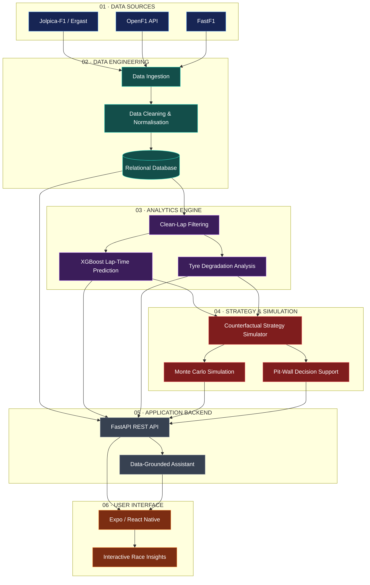

 <div align="center">

# 🏎️ OpenTyreF1

### Formula 1 Telemetry Analytics & Race Strategy Simulation


**A Data-Driven Mobile Platform for Formula 1 Telemetry Analysis and Race-Strategy Simulation**

<br/>


<br/><br/>

*Transforming historical race data into actionable strategic insights.*

</div>

---

## 🏁 Project Overview

**OpenTyreF1** is a data-driven Formula 1 analytics platform that combines motorsport data, machine learning, and race-strategy simulation to explore the decisions behind race performance.

The platform goes beyond conventional race statistics by enabling users to analyse telemetry, investigate tyre degradation, predict lap times, compare driver performance, and evaluate hypothetical pit-stop strategies.

Through a FastAPI backend and an Expo/React Native mobile application, OpenTyreF1 brings advanced race analytics into an accessible, interactive experience.

## ✨ Core Capabilities

- **📡 Multi-Source Data Integration** — Integrates data from Jolpica-F1/Ergast, OpenF1, and FastF1.
- **🏎️ Race & Driver Explorer** — Explore historical race results, drivers, lap times, and performance data.
- **📊 Telemetry Analytics** — Investigate pace, lap-time patterns, and comparative driver performance.
- **🛞 Tyre Degradation Modelling** — Study tyre performance across compounds and stints.
- **🤖 Machine Learning Predictions** — Apply XGBoost to estimate lap-time offsets.
- **🔬 Race Strategy Simulation** — Compare hypothetical pit-stop and tyre strategies with observed race performance.
- **🎲 Monte Carlo Analysis** — Estimate uncertainty in simulated race outcomes through repeated simulations.
- **🧠 Pit-Wall Decision Support** — Use analytical modules to explore strategy-related decisions.
- **💬 Data-Grounded Assistant** — Query available race information and analytical results.
- **📱 Cross-Platform Experience** — Access race insights through an Expo and React Native mobile application.

## 📈 Research & Evaluation

The following results are reported in the project's research paper and thesis.

<div align="center">

| Research Metric | Reported Result |
|:---|---:|
| Historical race coverage | **492 races** |
| Integrated data records | **237,308** |
| Relational database tables | **15** |
| Unseen races evaluated | **12** |
| Mean Absolute Error (MAE) | **0.893 s** |
| Root Mean Squared Error (RMSE) | **1.205 s** |
| Coefficient of Determination (R²) | **0.978** |
| Monte Carlo simulations | **1,500 runs** |

</div>

> **Evaluation note:** These figures reflect the reported project evaluation. They do not guarantee equivalent accuracy for every race, dataset, or deployment environment.

## 🛠️ Technology Stack

<div align="center">


</div>

| Layer | Technologies |
|:---|:---|
| Mobile application | Expo, React Native |
| Backend services | Python, FastAPI |
| Machine learning | XGBoost |
| Data processing | Python, pandas |
| Database | SQLite / PostgreSQL |
| Data access | SQLAlchemy |
| Data providers | Jolpica-F1, OpenF1, FastF1 |
| Visualisation | react-native-svg |
| Development workflow | Git, GitHub |

## 🏗️ System Architecture

OpenTyreF1 follows a modular architecture that connects public Formula 1 data sources with a backend analytics pipeline, machine learning models, strategy simulation, and a cross-platform mobile interface.



### Architecture Layers

| Layer | Responsibility |
|---|---|
| **Data Sources** | Retrieve available historical race, lap-time, and telemetry data. |
| **Data Engineering** | Clean, normalise, and organise data in a relational database. |
| **Analytics Engine** | Filter clean laps, predict lap-time offsets, and analyse tyre degradation. |
| **Strategy Simulation** | Evaluate hypothetical race strategies and estimate outcome uncertainty. |
| **Application Backend** | Expose analytical capabilities through FastAPI endpoints. |
| **Mobile Interface** | Present race information, model predictions, and strategy insights through Expo and React Native. |

**Data flow:** Public F1 data → Data processing → Analytics and prediction → Strategy simulation → API → Mobile application.


## ⚙️ Analytical Workflow

<ol>
<li><strong>Data collection</strong> — Retrieve available historical race results, lap times, pit stops, and tyre-stint information.</li>
<li><strong>Data integration</strong> — Normalise records and reconcile identifiers across supported data sources.</li>
<li><strong>Lap filtering</strong> — Select representative clean laps for performance modelling.</li>
<li><strong>Lap-time prediction</strong> — Use the trained XGBoost model to estimate lap-time offsets.</li>
<li><strong>Strategy simulation</strong> — Evaluate hypothetical stints and compare simulated performance with observed race data.</li>
<li><strong>Uncertainty estimation</strong> — Run Monte Carlo simulations to explore possible race outcomes.</li>
<li><strong>Mobile visualisation</strong> — Present the resulting insights through the mobile application.</li>
</ol>

## 🚀 Getting Started

The following commands are a **setup template**. Confirm the actual project directories, dependencies, and application entry points before using them.

### Prerequisites

- Git
- Python version supported by the project
- Node.js and npm
- Required environment variables and data-source configuration

### 1. Clone the repository

```bash
git clone https://github.com/YOUR_USERNAME/OpenTyreF1.git
cd OpenTyreF1
```

### 2. Configure the Python environment

```bash
python -m venv .venv
```

Activate the environment.

**Windows**

```bash
.venv\Scripts\activate
```

**macOS / Linux**

```bash
source .venv/bin/activate
```

Install the dependencies if the repository contains a `requirements.txt` file:

```bash
pip install -r requirements.txt
```

### 3. Run the backend

If the FastAPI entry point is `app.main:app`, start the development server with:

```bash
uvicorn app.main:app --reload
```

API documentation is typically available at:

`http://127.0.0.1:8000/docs`

### 4. Run the mobile application

Navigate to the actual mobile application directory and run:

```bash
npm install
npx expo start
```

**Note:** The Python entry point, directory names, and commands above are illustrative. Replace them with the configuration used by your actual source code.

## 📸 Application Preview

Add screenshots from the working application to demonstrate its interface and analytical features.

<div align="center">

| Race Dashboard | Telemetry Analysis |
|:---:|:---:|
| `screenshots/live-dashboard.png` | `screenshots/telemetry-analysis.png` |
| **Tyre Strategy** | **Simulation Results** |
| `screenshots/tyre-strategy.png` | `screenshots/simulation-results.png` |

</div>

Replace these placeholders with actual screenshots once the images have been uploaded to the repository.

## 📚 Research & Documentation

The project is supported by a thesis and research paper describing its methodology, system design, analytical approach, and evaluation.

- **Project thesis:** `docs/OpenTyreF1_Thesis.pdf`
- **Research paper:** `docs/OpenTyreF1_Research_Paper.pdf`

Update the paths above to match the actual document filenames and repository structure.

## 🗺️ Development Roadmap

- [x] Integrate public Formula 1 data sources
- [x] Develop the clean-lap filtering pipeline
- [x] Train and evaluate the XGBoost lap-time model
- [x] Implement counterfactual race-strategy simulation
- [x] Develop Monte Carlo outcome estimation
- [x] Build the cross-platform mobile interface
- [ ] Expand tyre and strategy modelling
- [ ] Improve automated testing and deployment
- [ ] Enhance telemetry visualisation
- [ ] Extend model evaluation across additional races

## 🤝 Contributing

Ideas, improvements, and bug reports are welcome.

1. Fork the repository.
2. Create a feature branch.
3. Implement and test your changes.
4. Commit your work with a clear message.
5. Open a pull request explaining the proposed improvement.

Please respect the licences and terms of all upstream data sources and dependencies.

## ⚠️ Disclaimer

OpenTyreF1 is an independent academic and engineering project. It is **not affiliated with, endorsed by, or an official product of Formula 1 or the FIA**. All trademarks belong to their respective owners.

Predictions and simulated outcomes are analytical estimates. They are not official race results or professional motorsport team recommendations.

## 👨‍💻 Project Team

Developed as a Bachelor of Technology project in Computer Science & Engineering at **G H Raisoni University, Amravati**.
- Ankit Sawalakhe

**Project Guide:** Mrs. Prachi Jain

---

<div align="center">


<br/>

**⭐ If you find OpenTyreF1 interesting, consider starring the repository.**

### OpenTyreF1 — From Telemetry to Strategy.

</div>
